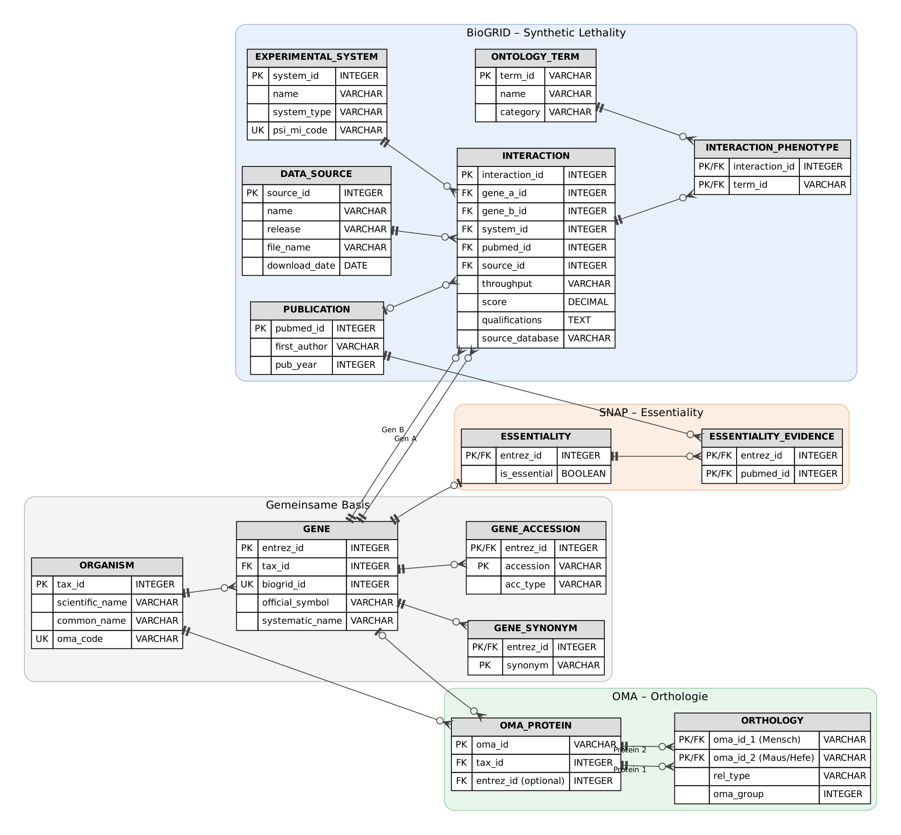

# 1 Projektübersicht

| | |
|---|---|
| **Gruppe** | Klug, Kranebitter, Scheuringer *(vierten Namen ergänzen)* |
| **Organismen** | *Mus musculus* (Hausmaus), *Saccharomyces cerevisiae* (Bierhefe), *Homo sapiens* (Mensch) |
| **DBMS** | PostgreSQL (getestet mit Version 16) |
| **Repository** | <https://github.com/NicoKeinBock/synlet-dbi-projekt> |

**Auftrag:** Eine Wissenschaftlerin aus der Krebsforschung hat eine Patientin mit einem mutierten Gen X. Sie möchte wissen, welche Gene mit X *synthetisch letal* sind. Wenn man ein solches Partnergen medikamentös hemmt, sterben nur die Krebszellen (dort ist X bereits defekt). Gesunde Zellen haben ein intaktes X und überleben.

Unsere Datenbank führt dafür drei Datenquellen zusammen und beantwortet die Frage mit einer einzigen Funktion: `sl_candidates('X')`.

# 2 Fachlicher Hintergrund

- **Synthetische Letalität (SL):** Zwei Gene sind synthetisch letal, wenn die Zelle den Ausfall von jeweils einem der beiden überlebt, den gleichzeitigen Ausfall beider aber nicht. Die Gene können sich also gegenseitig ersetzen.
- **Orthologe Gene:** Gene in verschiedenen Arten, die von einem gemeinsamen Vorfahren-Gen abstammen und meist eine ähnliche Funktion haben. Ist ein Genpaar in der Hefe SL, sind die menschlichen Orthologe möglicherweise auch SL.
- **Essentielle Gene:** Gene, ohne die eine Zelle nicht überlebt. Ein essentielles Gen ist ein schlechtes Medikamentenziel, weil seine Hemmung auch gesunde Zellen tötet.
- **Modellorganismen:** Maus und Hefe lassen sich im Labor leicht genetisch verändern. Deshalb gibt es für die Hefe sehr viele gemessene SL-Paare.

# 3 Datenquellen

| Bereich | Datei | Quelle | Version / Stand |
|---|---|---|---|
| Synthetic Lethality | `BIOGRID-SYSTEM-Synthetic_Lethality-5.0.263.tab3.txt` | BioGRID Latest Release | 5.0.263 |
| Interaktionen je Organismus | `BIOGRID-ORGANISM-{Homo_sapiens, Mus_musculus, Saccharomyces_cerevisiae_S288c}-4.4.225.mitab.txt` | BioGRID Release-Archiv | 4.4.225 |
| Orthologie | `OMA-Pairs_HUMAN-MOUSE_EntrezGene.csv`, `OMA-Pairs_HUMAN-YEAST_EntrezGene.csv` | OMA Browser, Genome Pair View | 27.11.2026 |
| Essentiality | `G-HumanEssential.tsv` | SNAP BioData (Stanford) | 27.11.2026 |

Die großen BioGRID-Dateien liegen gzip-komprimiert im Repository, weil GitHub Dateien über 100 MB ablehnt. Die OMA-Paare haben wir über die API hinter dem Formular geladen: `https://omabrowser.org/api/pairs/HUMAN/MOUSE/?format=csv&xrefs=EntrezGene&per_page=200000`.

# 4 Datenanalyse und ID-Mapping

## 4.1 Welche ID verbindet die Quellen?

| Quelle | Verfügbare Gen-IDs |
|---|---|
| BioGRID tab3 | Entrez Gene, BioGRID-ID, Systematic Name, Official Symbol, SWISS-PROT, TrEMBL, RefSeq |
| BioGRID MITAB | `entrez gene/locuslink:<id>`, dazu BioGRID-ID, Symbol, UniProt, RefSeq |
| SNAP | nur Entrez Gene (`Gene ID`) |
| OMA | frei wählbar, u. a. Entrez Gene, UniProt, Ensembl, RefSeq |

**Entscheidung:** Wir verwenden **NCBI Entrez Gene IDs** als gemeinsamen Schlüssel. SNAP liefert nur diese ID, BioGRID hat sie in jeder Zeile, und OMA kann sie direkt exportieren. Bei OMA haben wir deshalb „Entrez Gene IDs“ als Preferred ID gewählt.

## 4.2 Abdeckung

| Prüfung | Ergebnis |
|---|---|
| Menschliche SL-Gene mit Essentiality-Eintrag | 1.831 von 1.956 |
| Maus-SL-Gene mit menschlichem Ortholog | 44 von 50 |
| Hefe-SL-Gene mit menschlichem Ortholog | 1.315 von 3.661 |
| OMA Mensch–Maus-Paare ohne Entrez-ID (Mensch / Maus) | 3.271 / 2.593 von 22.292 |
| OMA Mensch–Hefe-Paare ohne Entrez-ID (Mensch / Hefe) | 238 / 1 von 3.124 |

Nachprüfbar mit Abfrage 8 in `sql/queries.sql`. Gezählt werden nur Orthologe, die auf beiden Seiten eine Entrez-ID haben. `scripts/check_coverage.py` zählt auch Paare ohne menschliche Entrez-ID und kommt daher auf 46 von 50 (Maus) bzw. 1.387 von 3.661 (Hefe).

## 4.3 Beobachtungen in den Rohdaten

- **Sehr wenige Maus-Daten:** BioGRID 5.0.263 enthält 17.777 SL-Paare in der Hefe, 2.255 im Menschen, aber nur 38 in der Maus (+3 Mensch–Maus, +11 Mensch–Hefe).
- **MITAB bringt keine zusätzlichen SL-Paare:** Alle SL-Zeilen der drei MITAB-Dateien 4.4.225 (z. B. 17.459 in der Hefe, 38 in der Maus) sind auch im neueren tab3-File 5.0.263 enthalten (gleiche BioGRID Interaction ID). Wir nutzen MITAB trotzdem, weil es Gensymbole und Accessions für Gene liefert, die nicht in SL-Paaren vorkommen, z. B. die menschlichen Orthologe.
- **SL in MITAB erkennen:** In Spalte 7 (Detection Method) steht bei allen genetischen Interaktionen `MI:0254 (genetic interference)`. Synthetic Lethality erkennt man nur an Spalte 12: `MI:2370 (synthetic lethality)`.
- **Mehrwertige Felder:** Synonyme, Accessions und Ontology Terms sind durch `|` getrennt und werden beim Import in eigene Tabellen aufgeteilt.
- **Leere Spalten:** In tab3 sind `Modification` und `Tags` immer `-`. `Throughput` kann `High Throughput|Low Throughput` sein.

# 5 Datenmodell



Eine bearbeitbare Version liegt am Whiteboard (Link im README), eine Mermaid-Version in `docs/ERD.md`.

## 5.1 Tabellen

| Tabelle | Inhalt | Zeilen |
|---|---|---:|
| `organism` | Mensch, Maus, Hefe (NCBI Taxonomy-ID als PK) | 3 |
| `gene` | Alle Gene aus BioGRID, OMA und SNAP | 45.689 |
| `gene_synonym` | Alternative Gennamen (aus tab3) | 13.207 |
| `gene_accession` | UniProt- und RefSeq-Nummern | 106.066 |
| `interaction` | SL-Interaktionen (Gen A, Gen B, Publikation, Quelle) | 20.084 |
| `experimental_system` | Art des Experiments, hier „Synthetic Lethality“ (`MI:2370`) | 1 |
| `publication` | PubMed-Artikel (aus BioGRID und SNAP) | 2.338 |
| `data_source` | Herkunft jeder Datei inkl. Version | 7 |
| `ontology_term`, `interaction_phenotype` | Beobachteter Phänotyp, z. B. `APO:0000112 inviable` | 60 / 21.043 |
| `oma_protein` | OMA-Proteine mit optionaler Entrez-ID | 38.172 |
| `orthology` | Orthologe Paare Mensch ↔ Maus/Hefe mit Typ (1:1, 1:n, m:1, m:n) | 25.416 |
| `essentiality`, `essentiality_evidence` | Essentiality menschlicher Gene mit Belegen | 18.528 / 56.338 |

## 5.2 Modellierungsentscheidungen

| Entscheidung | Begründung |
|---|---|
| Entrez Gene ID als PK von `gene` | Gemeinsamer Schlüssel aller drei Quellen, global eindeutig über alle Arten |
| Zwei FKs `gene_a_id`, `gene_b_id` in `interaction` | Jede Interaktion verbindet zwei Gene. Beide können aus verschiedenen Organismen stammen (es gibt Mensch–Hefe-Paare) |
| `oma_protein` als eigene Tabelle | OMA arbeitet auf Protein-Ebene, und ein Teil der Proteine hat keine Entrez-ID. Mit einer optionalen `entrez_id` gehen keine Orthologie-Paare verloren |
| `oma_id_1` ist immer das menschliche Protein | So exportiert OMA die Paare (Species 1 = Homo sapiens) |
| Eigene Tabellen für Synonyme, Accessions, Phänotypen | Die Felder sind mehrwertig, daher 1. Normalform |
| `essentiality` getrennt von `gene` | Nur für menschliche Gene vorhanden (Beziehung 1 : 0..1) |
| `data_source` | Unterscheidet BioGRID 5.0.263 (tab3) und 4.4.225 (MITAB) und dokumentiert die Herkunft |
| Nur unsere drei Organismen importiert | Das tab3-File enthält auch Spalthefe, Fruchtfliege usw. (1.687 Zeilen). Diese werden übersprungen |

# 6 Import

Der Import läuft in zwei Schritten, damit keine Programmiersprache mit Datenbanktreiber nötig ist:

1. `scripts/prepare_import.py` (nur Python-Standardbibliothek) liest die Rohdaten und schreibt pro Tabelle eine bereinigte CSV-Datei nach `build/`.
2. `sql/import.sql` lädt diese CSVs mit `\copy` in einer Transaktion.

**Regeln beim Aufbereiten:**

- Fehlende Werte (`-`) werden zu `NULL`.
- Es werden nur Interaktionen übernommen, bei denen beide Gene aus Mensch, Maus oder Hefe stammen.
- tab3 (5.0.263) hat Vorrang vor MITAB (4.4.225). Aus MITAB kommen nur SL-Zeilen (`MI:2370`) mit einer neuen Interaction ID dazu.
- Gene aus OMA und SNAP, die nicht in BioGRID vorkommen, werden mit ihrem Organismus angelegt, damit alle Fremdschlüssel gültig sind.
- Autor und Jahr werden aus Einträgen wie `Goehring AS (2003)` getrennt.

## Setup

```bash
python3 scripts/prepare_import.py
createdb synlet
psql -d synlet -f sql/schema.sql -f sql/import.sql -f sql/procedures.sql
psql -d synlet -f sql/queries.sql
```

Aufbereiten dauert etwa 40 Sekunden, der Import in PostgreSQL etwa 5 Sekunden.

# 7 Abfragen und Funktionen

## 7.1 Algorithmus

Für ein menschliches Gen X sammelt die Funktion Evidenz über zwei Wege:

1. **Direkt:** Es gibt ein SL-Paar X–P im Menschen.
2. **Über Orthologe:** X hat ein Ortholog X′ in Maus oder Hefe. X′ ist dort SL mit P′, und P′ hat ein menschliches Ortholog P. Dann ist P ein Kandidat.

Anschließend wird jeder Partner mit der Essentiality verknüpft. Sortiert wird nach der Anzahl der Organismen, die das Paar stützen, dann nach Essentiality (nicht essentiell zuerst), dann nach Anzahl der Interaktionen.

## 7.2 Objekte in `sql/procedures.sql`

| Objekt | Zweck |
|---|---|
| `v_sl_pair` | Jedes SL-Paar in beide Richtungen, damit man nur nach einem Gen filtern muss |
| `v_human_ortholog` | Orthologie auf Gen-Ebene (Mensch ↔ Maus/Hefe) |
| `v_sl_pair_readable` | SL-Paare mit Symbolen, Organismen und Publikation |
| `find_human_gene(text)` | Findet ein menschliches Gen über Entrez-ID, Symbol oder Synonym, sonst Fehlermeldung |
| `sl_partners(text)` | Alle SL-Partner, eine Zeile pro Partner und Evidenzweg |
| `sl_candidates(text)` | Zusammenfassung pro Partner mit Bewertung als Medikamentenziel |
| `orthologs_of(text)` | Orthologe eines menschlichen Gens |

## 7.3 Beispiel: BRCA1

`SELECT * FROM sl_candidates('BRCA1');`

| partner_symbol | n_organisms | organisms | is_essential | bewertung |
|---|---:|---|---|---|
| PARP1 | 2 | Homo sapiens, Mus musculus | false | Kandidat (nicht essentiell) |

Das ist das bekannteste Beispiel für synthetische Letalität in der Krebsforschung. PARP-Hemmer wie Olaparib werden bei Brust- und Eierstockkrebs mit BRCA-Mutation eingesetzt. Unsere Datenbank findet das Paar direkt im Menschen und zusätzlich über die Maus-Orthologe *Brca1*–*Parp1*.

## 7.4 Weitere Abfragen in `sql/queries.sql`

1. SL-Kandidaten für Gen X
2. Nur nicht-essentielle Kandidaten
3. Jede Evidenz einzeln
4. Orthologe von Gen X
5. SL-Interaktionen pro Organismus(-paar)
6. Gene mit den meisten SL-Partnern pro Organismus
7. Konservierte SL-Paare, die im Menschen und in Maus oder Hefe SL sind (7 Paare, z. B. BRCA1–PARP1, FEN1–MRE11A)
8. Übertragbarkeit der Modellorganismus-Gene auf den Menschen
9. Anteil essentieller Gene unter den menschlichen SL-Genen (433 von 1.956)
10. Verteilung der Orthologie-Typen
11. Häufigste Phänotypen
12. Publikationen mit den meisten SL-Interaktionen

# 8 Annahmen

Diese Punkte haben wir noch nicht mit der Auftraggeberin geklärt. Wir sind daher von folgenden Annahmen ausgegangen:

| Frage | Annahme |
|---|---|
| Nur Synthetic Lethality oder alle genetischen Interaktionen? | Nur Synthetic Lethality (`MI:2370`) |
| Werden Patient:innen bzw. die Mutation von Gen X gespeichert? | Nein, Gen X ist nur ein Parameter der Abfrage |
| Welches DBMS? | PostgreSQL. Für Oracle: `BOOLEAN` → `NUMBER(1)`, `TEXT` → `CLOB`, `SERIAL` → `IDENTITY` |
| Nur 1:1-Orthologe oder alle Typen? | Alle. Der Typ wird mit ausgegeben und kann zum Filtern verwendet werden |
| Gen X ist ein menschliches Gen | Ja, die Funktionen suchen Gen X nur unter den menschlichen Genen |

# 9 Einschränkungen

- **Maus:** Mit 38 SL-Paaren trägt die Maus kaum zu den Ergebnissen bei. Für 6.575 Maus-Gene, die nur über OMA in die Datenbank kommen, ist kein Gensymbol vorhanden.
- **Lücken bei Entrez-IDs:** Orthologie-Paare ohne Entrez-ID auf einer Seite können nicht mit BioGRID oder SNAP verknüpft werden.
- **Zwei BioGRID-Versionen:** Die Angabe gibt tab3 aus 5.0.263 und MITAB aus 4.4.225 vor.
- **Orthologie ist keine Garantie:** Ein in der Hefe gefundenes SL-Paar ist für den Menschen nur eine Hypothese, die im Labor bestätigt werden muss.
- **Essentiality ist zellabhängig:** SNAP fasst mehrere Studien zusammen. In bestimmten Geweben kann sich die Essentiality unterscheiden.

# 10 Verantwortlichkeiten

*Bitte vor der Abgabe ausfüllen.*

| Person | Aufgaben |
|---|---|
| Klug | |
| Kranebitter | |
| Scheuringer | |
| *(vierter Name)* | |

# 11 Quellen

- BioGRID: Stark C et al. *BioGRID: a general repository for interaction datasets.* Nucleic Acids Res. 2006;34:D535-9. <https://thebiogrid.org>
- BioGRID Curation Guide, genetische Experimentalsysteme: <https://wiki.thebiogrid.org/doku.php/curation_guide:genetic_experimental_systems>
- OMA Browser: <https://omabrowser.org>
- SNAP BioData, Human Essential Genes: <https://snap.stanford.edu/biodata/datasets/10033/10033-G-HumanEssential.html>
