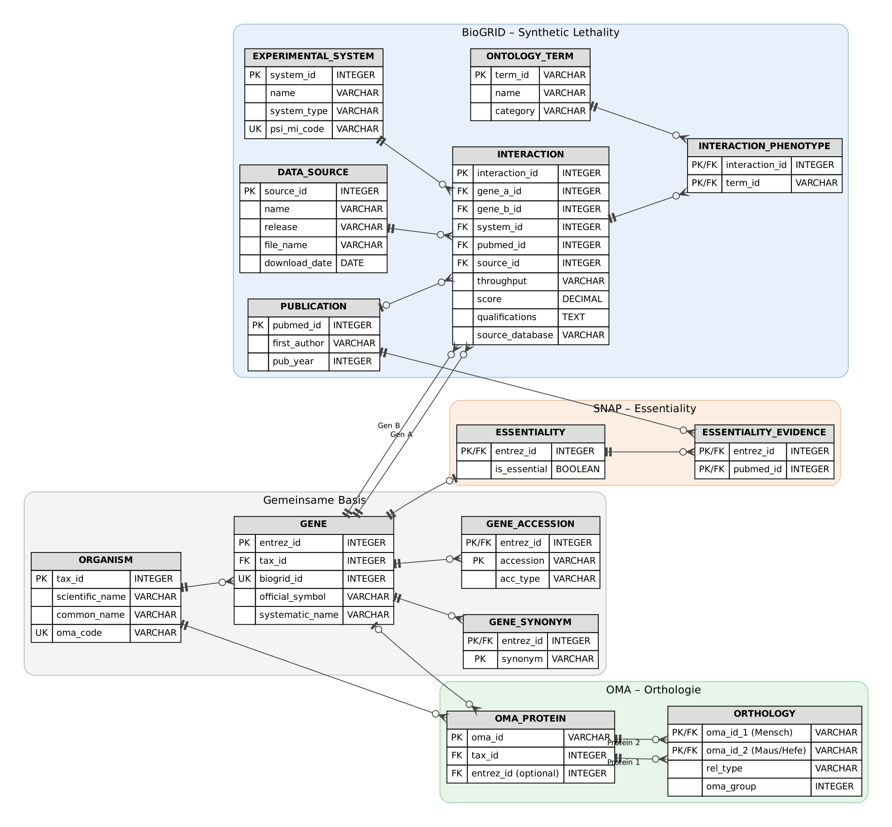

# Der Satz zum Einstieg

> In der Mitte steht **GENE**. Alle drei Datenquellen hängen über die **Entrez-ID** daran: BioGRID sagt, *welche Gene synthetisch letal sind*, OMA sagt, *welches Gen in Maus und Hefe welchem menschlichen Gen entspricht*, SNAP sagt, *welche menschlichen Gene essentiell sind*.

# Zahlen zum Merken

| | |
|---|---|
| SL-Interaktionen | 20.084 (Hefe 17.777, Mensch 2.255, Maus 38) |
| Gene | 45.689 |
| Orthologie-Paare | 25.416 |
| Gene mit Essentiality-Angabe | 18.528, davon 1.511 essentiell |
| Tabellen | 14 |

# So liest man das Diagramm

| Zeichen | Bedeutung |
|---|---|
| `||` | genau einer |
| `o|` | keiner oder einer |
| `o<` | keiner bis viele |
| Pfeil / Linie | Der FK steht immer auf der **n-Seite** |
| Zwischentabelle mit zwei PK/FK | löst eine **n:m-Beziehung** auf |

Beispiel: `ORGANISM → GENE` heißt „ein Organismus hat viele Gene“, deshalb steht `tax_id` als FK in GENE.

# Die vier Bereiche (in dieser Reihenfolge erklären)

**1. Gemeinsame Basis (grau)**

- `ORGANISM`: Mensch, Maus, Hefe. PK ist die NCBI-Taxonomy-ID.
- `GENE`: PK `entrez_id`. Jedes Gen gehört zu genau einem Organismus (1 : n).
- `GENE_SYNONYM`, `GENE_ACCESSION`: In BioGRID stehen mehrere Werte in einem Feld (getrennt mit `|`). Für die **1. Normalform** bekommen sie eigene Tabellen.

**2. BioGRID (blau): die SL-Paare**

- `INTERACTION`: eine Zeile pro gemessenem SL-Paar. **Zwei FKs auf GENE** (`gene_a_id`, `gene_b_id`), deshalb zwei Linien.
- Nachschlagetabellen: `PUBLICATION` (welche Studie), `EXPERIMENTAL_SYSTEM` (welches Experiment, hier `MI:2370`), `DATA_SOURCE` (welche Datei und Version).
- `INTERACTION_PHENOTYPE`: Zwischentabelle für die n:m-Beziehung zu `ONTOLOGY_TERM` (z. B. „inviable“).

**3. OMA (grün): die Orthologe**

- `OMA_PROTEIN`: OMA arbeitet mit Proteinen, nicht mit Genen. Die `entrez_id` ist **optional**, weil etwa 15 % keine Entrez-ID haben.
- `ORTHOLOGY`: verbindet zwei Proteine. `oma_id_1` ist immer der Mensch, `oma_id_2` Maus oder Hefe. Wieder zwei FKs auf dieselbe Tabelle. `rel_type` gibt den Typ an (1:1, 1:n, m:1, m:n).

**4. SNAP (orange): essentiell oder nicht**

- `ESSENTIALITY`: **1 : 0..1** zu GENE, weil nur menschliche Gene einen Eintrag haben, jedes höchstens einen.
- `ESSENTIALITY_EVIDENCE`: Zwischentabelle zu `PUBLICATION` (welche Studien es belegen).

# Durchspielen: BRCA1 → PARP1

| Schritt | Tabelle | Was passiert |
|---|---|---|
| 1 | `GENE` | BRCA1 suchen, Entrez-ID 672 |
| 2 | `INTERACTION` | BRCA1–PARP1 ist SL im Menschen (direkter Beleg) |
| 3 | `ORTHOLOGY` über `OMA_PROTEIN` | BRCA1 entspricht in der Maus *Brca1* |
| 4 | `INTERACTION` | *Brca1*–*Parp1* ist SL in der Maus |
| 5 | `ORTHOLOGY` | *Parp1* entspricht beim Menschen PARP1 (zweiter Beleg) |
| 6 | `ESSENTIALITY` | PARP1 ist nicht essentiell, also ein gutes Medikamentenziel |

Genau diesen Weg geht die Funktion `sl_candidates('BRCA1')`. Das Ergebnis ist das bekannte Paar hinter den PARP-Hemmern (z. B. Olaparib) bei Brust- und Eierstockkrebs.

# Wahrscheinliche Fragen

**Warum Entrez-ID als Primärschlüssel?**
Sie ist die einzige ID, die alle drei Quellen haben. SNAP liefert sogar nur diese. Außerdem ist sie über alle Arten hinweg eindeutig.

**Warum zwei Fremdschlüssel auf dieselbe Tabelle?**
Ein SL-Paar besteht immer aus zwei Genen. Die können sogar aus verschiedenen Arten stammen (es gibt Mensch–Hefe-Paare).

**Warum ist ESSENTIALITY keine Spalte in GENE?**
Sie gilt nur für menschliche Gene. Bei rund 24.000 Maus- und Hefe-Genen stünde sonst NULL.

**Warum OMA_PROTEIN statt direkt GENE?**
OMA liefert Proteine, und nicht jedes hat eine Entrez-ID. Mit einer eigenen Tabelle gehen diese Orthologie-Paare nicht verloren.

**Warum so viele kleine Tabellen?**
Mehrwertige Felder (Synonyme, Accessions, Phänotypen) würden sonst die 1. Normalform verletzen.

**Wozu DATA_SOURCE?**
Wir nutzen zwei BioGRID-Versionen (5.0.263 und 4.4.225). So ist bei jeder Interaktion nachvollziehbar, woher sie kommt.

**Warum hat die Maus so wenige Daten?**
BioGRID enthält nur 38 SL-Paare für die Maus, aber 17.777 für die Hefe. Hefe lässt sich viel leichter im Labor testen.
