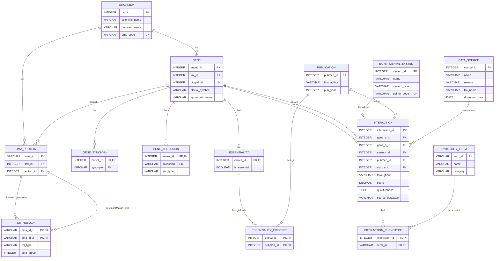

# ER-Diagramm

Interaktive Version (Whiteboard, zum gemeinsamen Bearbeiten): https://claude.ai/artifact/PZif19EJMd9ke5vmfKWYuL

Die Mermaid-Version unten wird von GitHub direkt als Diagramm angezeigt.

## Entscheidungen

| Entscheidung | Begründung |
|---|---|
| Entrez Gene ID als PK von `GENE` | Gemeinsamer Schlüssel von BioGRID, OMA und SNAP |
| Zwei FKs `gene_a_id` / `gene_b_id` in `INTERACTION` | Eine Interaktion verbindet immer zwei Gene; beide können aus verschiedenen Organismen stammen (z. B. Mensch–Hefe) |
| `OMA_PROTEIN` als eigene Tabelle | OMA arbeitet auf Protein-Ebene; ca. 15 % der Mensch–Maus-Paare haben keine Entrez-ID, daher ist `entrez_id` optional |
| `oma_id_1` = immer Mensch | So exportiert OMA die Paare (Species 1 = Homo sapiens) |
| `GENE_SYNONYM`, `GENE_ACCESSION`, `INTERACTION_PHENOTYPE` | Mehrwertige, durch `\|` getrennte Felder in BioGRID → 1. Normalform |
| `ESSENTIALITY` getrennt von `GENE` | Nur für menschliche Gene vorhanden (1 : 0..1) |
| `DATA_SOURCE` | Unterscheidet BioGRID 5.0.263 (tab3) und 4.4.225 (MITAB) |

## Offene Fragen an die Auftraggeberin

| Frage | Unser Vorschlag |
|---|---|
| Nur Synthetic Lethality oder alle genetischen Interaktionen aus MITAB? | Nur Synthetic Lethality (`MI:2370`) |
| Speichern wir Patient:innen und die Mutation von Gen X? | Nein, Gen X ist nur Abfrage-Parameter |
| Welches DBMS? | PostgreSQL (bei Oracle: `BOOLEAN` → `NUMBER(1)`) |
| Nur 1:1-Orthologe oder alle Typen? | Alle, `rel_type` dient als Filter |
